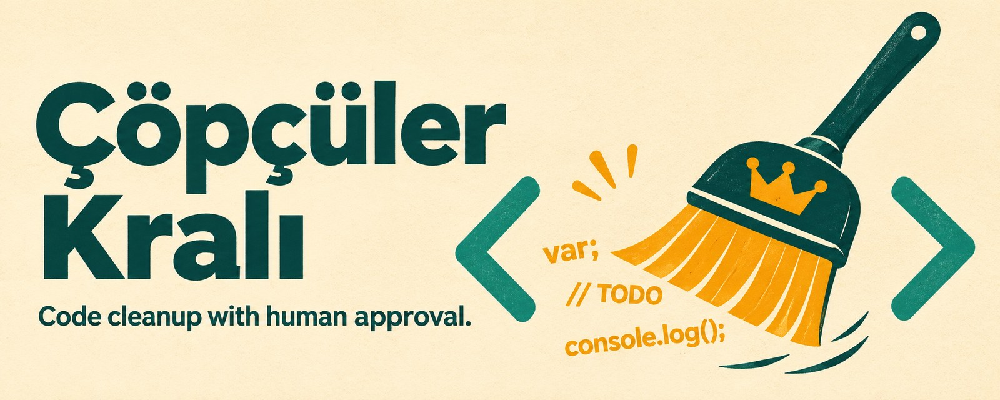

<p align="center">
  
</p>

# Çöpcüler Kralı (Trash King)


Code cleanup with human approval.

Çöpcüler Kralı reviews a local Git project for code and in-project text that can be deleted without changing behavior. An agent lists candidates together with their evidence. A local tool previews the deletion of selected lines or files and applies it only after **you** confirm in your own interactive terminal.

It works on a **local Git repository**. It never talks to GitHub or any other service, makes no network calls, calls no model, and runs no project code.

## Getting started

Requires Python 3.10+ and Git. Only the standard library is used. The tool is a single file (`temizlik.py`; "temizlik" means "cleanup" in Turkish). Open a Codex or Claude Code session in this folder and start with:

> Act as Çöpcüler Kralı and review `C:\Projects\MyProject`. List removable candidates with their evidence and prepare an approval plan.

The agent follows [AGENTS.md](AGENTS.md) and the [review protocol](docs/review-protocol.md). To work entirely with a local model, use the same two files as that model's session instructions and run the read commands only in the local session.

## Commands

| Command | Who runs it | What it does |
| --- | --- | --- |
| `snapshot <project>` | agent | Lists in-scope tracked files, a snapshot digest, and the **path and reason** of every out-of-scope file. Sensitive files are never opened. |
| `read <project> <file>` | agent | Reads one in-scope file. |
| `refs <project> <symbol>` | agent | Word-bounded search for a symbol: path and lines in scope, path and count in non-sensitive out-of-scope files, and unsearchable files under `not_reviewed` with a reason. |
| `review <project> <plan> --ids ... [--diff]` | agent | Validates candidates, prints each candidate's status (`REVIEW_COMPLETE` / `REVIEW_INCOMPLETE`) and syntax result, and produces a 64-character approval digest. |
| `apply <project> <plan> --ids ... --digest DIGEST` | **you** | Compares the digest, shows the patch, asks for `APPLY <digest>` in the terminal, and writes with a journal. |
| `undo <project> <receipt_id> [--require-git-check]` | **you** | Restores from the verified backup in the state directory and asks for `UNDO <digest>`. With `--require-git-check` it refuses unless the pinned Git commit verifies every restored file. |
| `recover <project> <receipt_id> --forward \| --backward` | **you** | Finishes an interrupted write (`--forward`) or reverts the files that were already written (`--backward`). Asks for `RECOVER <digest>`. |

`apply`, `undo` and `recover` only run in an interactive terminal. The agent never runs them.

## Review and approval

In PowerShell, run from the tool folder. The agent writes `plan.json` **outside** the target project; a plan inside the project is rejected. `C1` and `C3` are example candidate ids.

```powershell
$project = 'C:\Projects\MyProject'
python .\temizlik.py snapshot $project
python .\temizlik.py read $project 'src/report.py'
python .\temizlik.py refs $project old_report
python .\temizlik.py review $project .\plan.json --ids C1 C3 --diff
python .\temizlik.py apply $project .\plan.json --ids C1 C3 --digest REVIEW_DIGEST
```

Replace `REVIEW_DIGEST` with the 64-character digest printed by `review`, and type the confirmation line yourself. Run `review` again whenever the selection changes. The digest covers the action, the project, the pinned `base_commit`, the before and after hash of every file, the candidate statuses and the patch. Deletion is applied to the Git working tree; you manage staging and commits. The **receipt id** printed by `apply` is needed to undo.

```powershell
python .\temizlik.py undo $project RECEIPT_ID
```

Plan format. `symbols` lists the names bound by the code a candidate deletes (identifiers; see short names below).

```json
{
  "snapshot": "digest from the snapshot output",
  "candidates": [
    {"id": "C1", "path": "src/report.py", "action": "remove_lines", "lines": [[12, 12], [41, 45]], "symbols": ["old_report"]},
    {"id": "C3", "path": "src/old_report.py", "action": "delete_file", "symbols": ["OldReport"]}
  ]
}
```

Line numbers start at 1 and both ends are inclusive. Several ranges in one file go into a single candidate, in ascending order. A selection that would empty a directory is rejected.

## Candidate statuses

- `REVIEW_COMPLETE`: **all** of the following hold.
  - Every listed symbol really appears, word-bounded, in the deleted lines (a typo never yields `COMPLETE`).
  - Every name bound by a statement that lies entirely inside the deleted lines is listed in `symbols`: `def`/`class` names, assignment and `del` targets, `for`/`with ... as`/`except ... as` names, walrus (`:=`), `import`/`from-import` names (the `as` name if present), `global`/`nonlocal`, `match` captures and `type` aliases. Local names inside a deleted function, class or lambda body are not required (they cannot be reached from outside), and neither are type parameters.
  - After the whole selection is applied, no relevant reference to the symbols remains in any searchable file (see "Module-aware references" below).
  - There is no unreviewable source or template file.
- `REVIEW_INCOMPLETE(reason)`: one of the above is not met, or the tool cannot verify it. When it cannot verify something it says `INCOMPLETE`. A candidate that is `INCOMPLETE` **cannot be applied**; there is no override flag. Complete the evidence (symbols, `refs`), regenerate the plan and review again. Reasons include:
  - code is deleted but `symbols` is empty (comment-only deletions in Python and `.md`/`.txt` edits do not need `symbols`; if given they must still appear in the deleted lines),
  - a symbol does not appear in the deleted lines,
  - a deleted name is missing from `symbols`,
  - **deleted bindings could not be fully verified**: the tool met a binding path it does not recognise, or the source could not be parsed (`from x import *` included),
  - **attribute or index assignment cannot be verified**: a line such as `self.cache = {}` or `d["k"] = 1` is deleted on its own. The base name (`self`, `d`) is not a definition and is not asked for. Even if the attribute name (`cache`) is listed and found nowhere, the result stays `INCOMPLETE`, because dynamic access (`getattr`, `__dict__`) cannot be searched. (Deleting the assignment together with a whole function or class is fine.)
  - **the origin of names cannot be resolved because of `from x import *`**: a code-deleting candidate is `INCOMPLETE` when its own file keeps a star import, or when another file star-imports the candidate's module,
  - **the Python file could not be parsed**: every code-deleting candidate in that file is `INCOMPLETE` (comment-only deletions delete no code),
  - code is deleted in a language other than Python (definitions cannot be extracted),
  - relevant matches remain outside the deleted range or in out-of-scope files,
  - a sensitive or unsearchable source or template file (`.jinja .j2 .hbs .ejs .erb .njk .twig .liquid .cshtml .razor` included) could not be reviewed.

If the project contains an unreviewable source such as `secrets.py`, every candidate is `INCOMPLETE`, because what is inside that file cannot be known. This is deliberately conservative.

**Module-aware references.** A name that appears in another file does not automatically depend on the candidate module. For Python candidates, a match in another Python file is ignored (and reported as a `Note` in the review output) only when **all** of these hold:
- the file parses,
- it never mentions the candidate module's name (not even in a string or comment),
- it uses no dynamic-import machinery (`importlib`, `__import__`, `import_module`, `sys.modules`),
- every textual match of the symbol in it is an identifier in the AST, so nothing hides in a comment or string.

Matches in non-Python files, templates, unparsable files, the candidate's own file, or any file that mentions the module stay relevant. This applies to in-scope files and to non-sensitive out-of-scope files (for example backup copies), without removing anything from the scan.

**Short names.** `symbols` accepts 1–2 character identifiers (`os`, `fn`), but only if they appear in the candidate's deleted lines. A short name that remains relevant elsewhere (comments and text included) makes the candidate `INCOMPLETE`. A deleted short name that is not listed gives the reason "short names not listed in symbols, so they could not be searched". `refs` still requires at least 3 characters.

## Limits of these results

The syntax check only catches certain structural errors in supported languages. **In practice only Python (`ast`) is verified**: `.json` and `.toml` (Python 3.11+) have a check, but those files are not editable, so it never runs in the `apply` pipeline. In other languages the result is `UNVERIFIED`, which does not mean passed. That a file can be parsed does **not** prove that the deletion preserves behavior; it is only a structural check. Running the tool on a newer Python only makes that Python's newer syntax parseable and removes parse-related `INCOMPLETE` results for it; all other evidence required for `COMPLETE` still applies. If the tool runs on Python 3.10 and the project uses newer syntax (`type X = int`), the file cannot be parsed and code-deleting candidates in it are `INCOMPLETE`.

`REVIEW_COMPLETE` only says that no relevant reference outside the deleted range was found in any searchable file. It is not evidence about dynamic access, reflection or consumers outside the project. Behavior tests that you run provide additional evidence; uncertainty remains for uses the tests do not cover. The tool makes no claim of semantic correctness. `review` prints this limit every time.

`apply` rejects, before writing: a change that introduces a syntax error into a file that parsed before, deleted lines containing directives and protection patterns (`#!`, `type: ignore`, `noqa`, `eslint-`, `@ts-ignore`, `//go:`, `pragma`, `SPDX-License-Identifier` and so on; an encoding declaration `# coding:` only on the first two lines), and deleting a Python docstring whose owner stays. `undo` and `recover` do **not** apply these checks: restoring the original content from a verified backup must always be possible.

## State directory and trust model

Undo backups, journals and the index file (`index.jsonl`) live in the **state directory**:

- `COPCULER_STATE_DIR` if set,
- otherwise `%LOCALAPPDATA%\copculer_kral` on Windows and `$XDG_STATE_HOME/copculer_kral` or `~/.local/state/copculer_kral` elsewhere (mode `0700` on POSIX).

If the state directory or the plan file is inside the target project, the operation is rejected.

Trust model:

- The review process (the agent) has read-only access to the target project and its `.git` directory. It does not touch the state directory. `apply`, `undo` and `recover` run only in your terminal.
- In the agent environment, deny: the `apply`, `undo` and `recover` commands, writes to the state directory, and writes to the target's `.git` directory. In Codex or Claude Code permission settings define these command patterns and paths as `deny`, and allow only `snapshot`, `read`, `refs`, `review`.
- The confirmation prompt (`APPLY|UNDO|RECOVER <digest>`) is a human-in-the-loop gate, not a security boundary. The `isatty` check is only an interaction check; an agent that can allocate a pseudo-terminal could read and type the line. The real barrier is the permission setup above: deny the agent those commands.
- Repositories whose local `.git/config` defines settings that run commands on files (`filter.*.clean|smudge|process`, `diff.*.textconv|command`, `diff.external`) are refused by every command, because `git apply` could run them. System and global Git config is always ignored, and `include.path` includes are expanded before the check, so a filter cannot hide behind an included file. The `git` executable is looked up on `PATH` and refused if it resolves to a file inside the target project. Review such repositories by hand.
- The patch shown for confirmation is display-sanitized: control characters, bidirectional and other invisible Unicode characters are shown as escapes (`\x1b`, `‮`), so a file cannot repaint the terminal to hide what is being deleted. The digest and the written patch use the real bytes. The same escaping applies to `snapshot` and `refs` JSON (file names come from the repository) and to `read` when stdout is a terminal; when `read` is piped or redirected it writes the raw bytes. If the agent can write to the state directory or to `.git`, the reliable-undo guarantee is void.
- The state directory holds source-content backups. Keep it away from hosted agents and manage its retention yourself.

## Where undo gets its trust

- **The primary source of trust** is the `before/*.bin` backup in the state directory. Its hash is in `receipt.json`, and the hash of `receipt.json` is in `index.jsonl`. `undo` verifies them. It does not use any `patch` field in the receipt; the patch is regenerated from the backup every time.
- **The second cross-check** is the pinned `base_commit`: the file's blob in that commit and its content must match the backup byte for byte. If the commit is no longer reachable (gc, reset) the check is reported as "not possible" and only the backup is used. Files with uncommitted changes have no blob record.
- If you changed a file after applying, `undo` refuses and lists the files.
- Someone who can write to the state directory can change both the backup and the digests consistently. The Git cross-check catches that, but not if they can also write to `.git`. The cross-check is also **skipped** (and reported as "not possible") when the receipt has no `base_commit`, the commit is unreachable, or a file had no recorded blob, and a person who can rewrite the receipt can force that skip. Use `undo --require-git-check` when you want the skip to be a refusal instead.
- The lock is best-effort: while an interrupted receipt exists, a new `apply`/`undo` is refused, but a race between two concurrent processes is not prevented. Stop other processes that modify the same working tree while you apply or undo.

## Journal states

Every receipt has a single `journal.json` describing its latest operation: `direction` (`apply` or `undo`) and `status`.

| direction | status | Meaning | Next step |
| --- | --- | --- | --- |
| `apply` | `complete` | Cleanup applied | `undo` is possible |
| `apply` | `reverted` | A partial apply was reverted with `recover --backward`; nothing is applied | none |
| `undo` | `complete` | Undone | none |
| `undo` | `reverted` | A partial undo was reverted with `recover --backward`; the cleanup is applied again | `undo` can be repeated |
| any | `pending` / `partial` | The write was interrupted (crash or error) | `recover --forward` or `--backward` |

`undo` overwrites the journal of the `apply` operation. While a `pending` or `partial` journal exists for a project, a new `apply`/`undo` is refused.

**Deleted receipts.** If you delete a receipt's folder (or only its `journal.json`), that receipt is ignored with a warning and does not lock the project. `undo`/`recover` is then no longer possible for it. If a journal exists but is corrupt, the tool stays on the safe side and refuses; deleting that receipt's folder resolves it (and knowingly gives up that operation's undo).

## Partial failure and recovery

Writing happens file by file, verified after each file and recorded in the journal. If a file fails, the journal becomes `partial` and the error message gives the receipt id. A new `apply`/`undo` is refused. `recover` looks at each file's current hash: equal to the earlier state means untouched, equal to the target state means applied. A file that matches neither is a **user change** made in between; if there is one, no file is touched and the list is printed.

## Privacy

- Works on files tracked by Git. Files whose name or directory is sensitive (`secrets`, `credentials`, `private`, `dumps`, `.env*`, `*.pem`, `*.key`, `.npmrc` and so on) are **never opened**; only the path and the reason are reported. Files with non-sensitive names are scanned for known key and password patterns; a match makes the file `secret_content`, out of scope and unsearched. The filters cannot recognise every kind of secret. The file limit is 1 MB for `read` and `review`, and 5 MB for `refs` in non-sensitive out-of-scope files.
- `read`, `review --diff` and the patch output of `apply`/`undo`/`recover` can expose source text. If run in a hosted agent session, the output can enter that session's context. If the source must stay on the device, use a local model and a local terminal.
- The tool makes no network calls and runs no project code. Recommended tests are named in the report; the digest and patch checks do not replace them.

## Tests

```powershell
python -m unittest discover -s tests -v
```

Tests run only in temporary Git repositories created with `tempfile` and a temporary `COPCULER_STATE_DIR`. They run under `%TEMP%`, so OneDrive synchronization has never been tested. Situations that cannot be imitated in the environment (OneDrive, CRLF/autocrlf variations, LFS and filters, the POSIX executable bit, real terminal confirmation) are manual checks in [docs/manual-checks.md](docs/manual-checks.md) and do not count as passed until observed.

## License

MIT, see [LICENSE](LICENSE).
